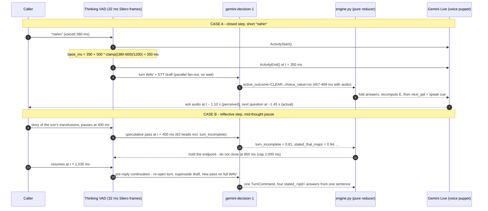

# SHISHU V3 — Moldable Voice Patient Intake & Thinking VAD

**Status:** design of record for branch `v3`. **Scope:** `intake/`, `packs/<pack_id>/`, `docs/`.
**Companion code:** `intake/models.py` (typed vocabulary), `intake/pack.py` (pack loader + startup validator).

---

## 1. Why V3 Exists

V3 is a voice patient-intake **engine**, not a rare-disease **app**. Clinical content moves out of Python into
declarative packs. The engine owns five things and nothing else: endpointing, turn classification, deterministic state
reduction, atomic persistence, and the two template-rendered artifacts.

```
passcode  ->  consent + first-time open-speech priming  ->  structured voice + quick-tap
          ->  deterministic, zero-LLM Patient PDF + Clinician Summary
```

Three invariants hold across every pack: **post-call is pure** (both artifacts are functions of stored `CallState`,
zero LLM calls after hangup); **silence is never an answer** (`AnswerStatus.UNKNOWN` is a *resolved* state and the
words survive verbatim — the form never hangs up on a value it has no slot for); **one forward pass per turn** (no
sidecar re-reading pass, no uncached 10,000-word prompt).

### 1.1 The size problem

V2 (`code/shishu-v2/`) is a single-purpose rare-disease screening app that grew to **10,112 LOC** — the figure in the V3
brief, measured today at 10,264: 5,990 lines of Python (`app.py`, `engine.py`, `gemini_live.py`, `decisions.py`, `db.py`,
…) and 4,274 of browser plus schema (`call.html`, `call.js`, `admin.*`, `decision_*.json`).

Roughly 1,600 of those lines were clinical content any second use case would have to rewrite: `triage_catalog.py` (56
atomic items and their follow-ups), `copy_hi.py` (every Hindi string), and the demographic skip matrix baked into
`engine.py`. Every new intake — a fever OPD, an immunisation register — would fork the app. **V3 target: `intake/` at or
under 1,950 LOC**, clinical content at zero lines of Python.

| Module | Role | Measured LOC |
|---|---|---:|
| `intake/models.py` | typed vocabulary: `CallState`, `TurnCommand`, `AnswerRecord`, `QuestionSpec`, `PackConfig` | 105 |
| `intake/pack.py` | `load_pack`, `list_pack_ids`, startup validation | 61 |
| `intake/engine.py` | pure reactive reducer, eligibility set `E`, rules/skip/reopen evaluation | 350 |
| `intake/decisions.py` + `extractor.py` | 4-group multimodal `gemini-decision-1` router + schema extractor | 220 |
| `intake/vad.py` + `audio.py` | Silero ONNX Thinking VAD (`base_ms * pace_factor`) + stereo 16 kHz WAV | 147 |
| `intake/live.py` | Gemini Live session, `ActivityStart`/`ActivityEnd`, speculative turns, watchdogs | 453 |
| `intake/reports.py` | Jinja2 → WeasyPrint PDF + clinician markdown projection | 202 |
| `intake/app.py` + `intake/db.py` | passcode auth, pack routes, bug drawer API, atomic SQLite | 300 |
| **Python Engine Subtotal (`intake/*.py`)** | | **1,839** |
| **Web Client + Admin (`intake/static/*.{js,html}`)** | `login.html` (82), `call.html` (71), `call.js` (281), `admin.html` (90), `admin.js` (190) | **714** |
| **Total Runtime Code** | *(vs `10,112` LOC in V2 — a **4.0x** overall and **3.3x** Python / **5.8x** JS+HTML reduction)* | **2,553** |

The pack surface replacing the deleted content is `packs/<pack_id>/` — plain YAML, loaded by `load_pack(pack_id)`
(default `DEFAULT_PACK_ID = "shishu-hi"`, override via `INTAKE_PACK`, `lru_cache`d per process).

### 1.2 The product loop

| Step | Engine responsibility | Pack responsibility |
|---|---|---|
| **1. Passcode login** | session cookie, one shared clinic passcode | — |
| **2. Consent** | serve `assets/SHISHU-consent.pdf`, record acceptance | consent wording, asset |
| **3. First-time open-speech priming** | fire `intro_bridge` once, show `ui.yes_no_prime` on first yes/no render | bridge copy, prime copy |
| **4. Structured voice + quick-tap** | VAD, one decision pass, reducer, re-ask policy | `form`, `followups`, `rules`, `semantic_flags` |
| **5. Deterministic artifacts** | `patient.html.j2` + `clinician.md.j2` + `pdf.css` → PDF | templates, `report:` config |

**Non-goals:** no screening claims in patient-facing copy, no diagnosis names in the Patient PDF, no server-side
WhatsApp/email send, no EHR integration, no per-pack Python.

---

## 2. First-Principles Lessons from FormBharo

FormBharo (`3rdparty/2608.06027v1.pdf`) is the empirical ancestor: a Hindi voice agent that fills a structured
enrolment form for ARMMAN under latency and cost budgets. Its production `FINDINGS/` are the failure catalogue V3 is
designed against.

### 2.1 The five-layer anatomy

| # | Layer | Job | V3 module |
|---|---|---|---|
| 1 | **Orchestrator & Thinking VAD** | decide when a turn ended, and whether it ended at all | `vad.py`, `live.py` |
| 2 | **Voice Puppet & narrow open extractor** | say exactly what the form says; pull free text without inventing structure | `live.py` tool, `engine.py` |
| 3 | **Multimodal decision layer** | one pass over audio + draft → typed `TurnCommand` | `decisions.py` |
| 4 | **Reactive policy & form reducer** | skip matrix, re-asks, follow-ups, cursor — pure | `engine.py` |
| 5 | **Atomic persistence & template artifacts** | commit then speak; render from committed state | `db.py`, `report.py` |

Each boundary is where a documented FormBharo defect becomes *structurally* impossible, not merely unlikely.

### 2.2 Five empirical lessons, and the V3 answer

**(a) The Indic STT cascade cliff.** Median form completion falls **7.67 pp** with Saaras v3, **7.38 pp** with Scribe
v2, and **13.56 pp** with Nova-3 versus reference transcripts, while per-turn extraction falls only 0.42–3.14 pp; the
worst model-specific decline is **~41 pp** (GLM-5.1). Component accuracy does not predict end-to-end accuracy, because
errors both propagate *and cancel*. → **V3 sends the raw 16 kHz turn WAV alongside the STT draft on every spoken turn**
(+85 audio tokens, +~10 ms for a 2.8 s turn, §3.1). The draft is a hint, not the evidence: a dropped digit or a
mis-heard "दो" versus "दोनों" is recoverable because the model hears it.

**(b) Latency bloat from uncached re-reading.** `armman/FINDINGS/why-the-caller-waits.md` decomposes a 4 s wait: 0.4 s
hearing, 0.8 s endpointing, **3.1 s reading the form**, 1.1 s deciding, 0.2 s speaking. The 3.1 s step sends ~10,000
words every turn — every question, option, and rule, plus state — with no `cache_control` anywhere, at
`reasoning_effort="medium"` while the speaking step runs at `"low"`. → V3 has **no sidecar reading prompt**: the head
spec is 250–11,237 tokens depending on group count, the form lives in the *state slice* the reducer selects, and there
is exactly one model call per turn.

**(c) Silent reasoning stalls.** On 87 calls, **37** ended with the nurse dictating a full set of observations and the
agent replying with nothing but its greeting; 22 were abandoned; 28 ran properly. In the lab, **17 of 266** reply tests
returned `{"response": "", "tool_calls": []}` — the correct Hindi sentence had been stamped as *reasoning*, not *reply*.
The 10 s/60 s safety net never fired once, because it stops counting the moment the model *starts* answering, and an
empty answer still counts as starting. → V3's decision output is **structured JSON with required keys**, not a reply
string: a missing key is a schema failure, which is loud, and empty speech is not a legal state.

**(d) Generative state drift.** `armman/FINDINGS/agent-defects.md`: the agent invents a retry *after* a clean save, and
skips ahead then comes back; a call can pass every turn and still end with the wrong form. → V3 forbids the model from
moving the cursor. `TurnCommand` carries *evidence* (`outcome`, `value`, `next_qid_probs`, `jump_topic`); `engine.py`
alone advances `CallState.cursor`, and re-asks are counted in `CursorStep.attempts` by the reducer.

**(e) Premature storage claims, and hanging up on real readings.** `intelehealth/FINDINGS/values-the-form-refuses.md`:
a nurse says "4 centimetres" three times, the picker starts at 5, and **36 of 39 questions hang up after two retries**;
temperature 97 (Fahrenheit) is silently discarded, and the refusal never reaches whoever chose the range. → V3 splits
speech from commitment (the puppet speaks a *next-question cue*, never "I saved that", and persistence commits first).
An out-of-range or unrecognised answer becomes `AnswerStatus.UNKNOWN`, which `is_resolved` returns `True` for — the step
closes, the words stay in `NoteText.verbatim`, and `redact_patient_note` keeps them out of `NoteText.patient_safe`.

---

## 3. Single-Pass Multimodal Decision Router (`gemini-decision-1`)

### 3.1 Measured benchmarks

India → Google, persistent HTTP keep-alive, `$0.10 / 1M` input tokens, `$0` output tokens (structured heads only).

| Turn shape | Prompt tokens | Latency p50 | Cost / call |
|---|---:|---:|---:|
| 3 small heads | ~250 | 277–294 ms | $0.001 |
| 7–8 heads + 58-option `choice` | ~2,430 | 345–421 ms | $0.010 |
| Audio + Text (2.8 s 16 kHz WAV = +85 audio tokens) | ~2,515 | 457–469 ms | $0.010 |
| 46–63 parallel heads (full reflective turn) | 5,880–11,237 | 375–489 ms | $0.024–$0.045 |

For reference, one minute of Gemini Live audio runs ~$0.23; a 40-turn SHISHU call at 46 heads is ~$1.00 of
classification against ~$4.60 of live audio. Audio conditioning is therefore affordable on **every** turn, and all four
head groups below run in one forward pass with no chaining.

### 3.2 The four parallel head groups

**Group A — safety, endpointing, privacy, and the active answer.**

| Head | Type | Lands in `TurnCommand` |
|---|---|---|
| `danger_now`, `caller_stop` | `noul` | `emergency`, `caller_stop` |
| `turn_incomplete`, `redact_patient_note` | `noul` | `turn_incomplete`, `redacted` |
| `mentions_profile`, `detail_present` | `noul` | `profile_turn_attempted` + `profile_patch`, `followup_answered` |
| `active_outcome` | `choice` over `TurnOutcome` | `outcome` |
| `choice_value` / `opt_<k>` / `score_value` | `choice` / `noul` per option / `noul` `0..K` | `value` |
| `item_ref` | `choice` over the roster (only `roster_scoped`) | `item_ref` |

`noul` heads are a single logit with no choice set; `choice` heads are a softmax over pack-rendered options. Group A
is the only group whose heads change identity per turn — the request builder emits `choice_value` *or* `opt_<k>` *or*
`score_value` depending on `QuestionSpec.kind` (`SINGLE_CHOICE`, `MULTI_CHOICE`, `SCORE`). Downstream, nothing cares
which head produced `outcome` or `value`.

**Group B — parallel `stated_<qid>` auto-fill and revision.** V2 shipped a single-winner `side_qid` head over all
routable items, and its probability-splitting bug is fatal for exactly the answers SHISHU wants. One sentence answering
four questions at once — *"बेटे को थैलेसीमिया मेजर है, हर महीने खून चढ़ता है, तिल्ली बढ़ी हुई है, और दो बार अस्पताल में भरती
हुआ है।"* (Thalassemia Major, monthly transfusions, enlarged spleen, two hospital admissions) — is one observation and
four answers, but a `choice` head must give 100% of its mass to one of them, so three are lost however well calibrated
it is. V3 replaces it with `N` independent `stated_<qid>` `noul` heads, one per id in the eligible set `E`, each
scoring "did this sentence state an answer to *this* question". Multi-answer turns become the normal case, and a later
turn can revise an earlier `stated` value because `stated` merges id-by-id into `CallState.answers` (typed
`dict[str, TurnOutcome]` on `TurnCommand`) rather than winning a winner-take-all slot.

**Group C — pack-defined `semantic_flags`.** For each entry in `PackConfig.semantic_flags` the pack declares a `flag_<id>`
`noul` head plus the implication that consumes it, so a hematology pack can say `confirmed_hemoglobinopathy → skip
redundant hematology probes` without the engine knowing what hematology is. The flag *prunes only the questions the pack
names as skippable*; it cannot reach an unrelated organ system — the difference between a clinical shortcut and an
unconstrained LLM deciding what not to ask.

**Group D — dynamic topic router.** `jump_topic` (`noul`) asks "did the caller change subject?"; `next_qid` (`choice`
over `E`) asks "which question is she answering or asking to reach?". Both are advisory; the reducer intersects the
posterior with the post-turn eligible open set:

```
jump_to = argmax_{q in E} P_next_qid(q)     # E computed after the turn's own answers are folded in
```

`E` is computed *after* the turn reduces, so a question just answered by Group B can never be a jump target, and a
pack `skip_if` rule that fires this turn is honoured before the argmax. This is why V3 does not repeat the "skips ahead
and comes back" defect: the model proposes, the reducer disposes.

### 3.3 Gating

Every head is thresholded by `packs/<pack_id>/decisions.yaml → thresholds`, validated at startup against the 17 keys in
`pack._REQUIRED_THRESHOLDS`: `*_min_confidence`/`*_min_margin` pairs for the `choice` heads (`outcome`, `choice`,
`stated`, `item_ref`, plus `score_min_confidence`), and `*_min_yes` cut-offs for the `noul` heads (`danger_now`,
`caller_stop`, `turn_incomplete`, `mentions_profile`, `redact_patient_note`, `detail_present`, `jump_topic`,
`multi_choice`). Safety heads are evaluated **first and unconditionally**; a `danger_now` above threshold returns a
`CloseReason.EMERGENCY` path regardless of what the answer heads said. A pack that omits any required threshold fails to
load — there is no default and no "0.5 will do".

---

## 4. Adaptive "Thinking VAD" & Per-Caller Pace Calibration

### 4.1 Why the built-in detector cannot be used

Gemini Live's `AutomaticActivityDetection` is configured once, at `connect()`. V2 pins it at
`silence_duration_ms=1000`, `prefix_padding_ms=300` (`code/shishu-v2/gemini_live.py`), frozen for the whole call — a
single guess about a caller who has not said a word yet, against a clinic whose acoustics change mid-call (a ceiling
fan, a hallway conversation, a child in the room). One number cannot serve both ends: a gate answer of "नहीं" wants
~350 ms, and a mother telling the story of her son's transfusions wants 1,500 ms or more.

V3 sets `AutomaticActivityDetection(disabled=True)` and drives turn boundaries itself from a `32 ms` frame clock
running Silero ONNX (`intake/assets/silero_vad.onnx`) on a `512`-sample window plus `64`-sample left context at
`16 kHz`. On confirmed onset the client sends `ActivityStart()`; when the endpoint timer expires it sends
`ActivityEnd()`. Both are server-driven, so the gate is recomputed every turn from the caller's own behaviour.

### 4.2 The two-factor formula

```
wait_ms = base_ms(question_kind, voiced_ms) * pace_factor(caller)
```

**`base_ms` — how long this *kind* of question deserves.** Reflective steps (`profile`, `followup`, `multi_choice`,
`open_capture`) get a flat **850 ms**: a story is never a fixed length, so a ramp buys nothing. Closed steps (`gate`,
`bridge`, `single_choice`) get a smooth ramp so a two-syllable answer is not punished for being short and a long,
hedged answer is not cut. `QuestionSpec.is_reflective_vad` covers the kinds (`profile`, `multi_choice`, `open_capture`);
a follow-up substep is reflective because `SubStep.FOLLOWUP` outranks the kind. `routing_gate` follows `bridge`, and
`score` follows `multi_choice`:

```
base_ms = 350 + 500 * clamp((voiced_ms - 600) / 1200, 0, 1)
```

0 ms voiced → 350 ms wait. 600 ms → 350 ms. 1,800 ms → 850 ms. The ramp is continuous, so no caller hears the detector
change its mind.

**`pace_factor(caller)` — how this caller pauses *inside* a turn.** Measured from `V → _ → V` boundaries: a voiced run, a
silence of `150–850 ms`, then more voicing, counted within one turn; `n` is how many such boundaries this call has seen.

```
pace_factor = clamp(1.0 + min(1.0, n / 8) * (median(pauses_ms) / 260 - 1.0), 0.80, 1.45)
```

`median(pauses_ms) / 260` is the caller's pause length against the population median of 260 ms; `min(1.0, n / 8)` is
trust — after eight boundaries the measurement is fully believed, before that it is shrunk toward 1.0 so an early fluke
cannot reshape the call. The clamp bounds the worst case: at 1.45 the longest reflective wait is 1,232 ms, at 0.80 the
shortest closed wait is 280 ms.

| Caller | `n` | `median(pauses_ms)` | raw | `pace_factor` | reflective `wait_ms` |
|---|---:|---:|---:|---:|---:|
| Slow, deliberating | 8 | 390 | 1.50 | 1.45 (clamped) | 1,232 ms |
| Median | 8 | 260 | 1.00 | 1.00 | 850 ms |
| Brisk | 8 | 170 | 0.65 | 0.80 (clamped) | 680 ms |
| Early call | 2 | 500 | 1.18 | 1.05 | 893 ms |

**Pre-reply continuation self-healing.** A caller can resume *before* the bot's audio starts. Because `ActivityEnd()` has
already fired and the decision pass is in flight, that audio would otherwise be attributed to the next turn and the
half-sentence lost. V3 treats pre-audio caller voice as a **continuation of the same turn**: the endpoint re-opens, the
in-flight draft is superseded, and the new pass sees the full turn WAV. Nothing is re-asked; nothing is spoken over her.

### 4.3 `V -> _ -> V` in the time domain

```
amplitude      ActivityEnd()                 ActivityStart() (resume)
   ^               |                                 |
1.0|  ▁▂▄█▇▅▃▂▁    |      ▁▃▅█▆▄▂▁               ▁▂▄▆█▇▅▃▁
   | ▁▃▅███████▅▃▁▁ |    ▁▄▆█████▆▄▁            ▁▃▅███████▅▂▁
0.0+━━━━━━━━━━━━━━━━━━━━━━━━━━━━━━━━━━━━━━━━━━━━━━━━━━━━━━━▶ t
    V (first run) |←  _  →|  V (second run)     ...
 0 ms        voiced_ms  silence: 150-850 ms
                  |       |<-- V -> _ -> V boundary -->|  (pace_factor sample)
            decision pass starts (WAV + draft)   continuation self-heal: draft
                                                 superseded, same turn re-opened
```

### 4.4 Sequence: short closed answer versus reflective turn



### 4.5 Latency budget

| Stage | V2 (`silence_duration_ms=1000`, frozen) | V3 Case A | V3 Case B |
|---|---:|---:|---:|
| Endpoint detection | 1,000 ms | 350 ms | 400 ms speculative, held to ≤2,000 ms |
| Decision pass + reducer + cue | ~1,500 ms | ~650 ms | ~650 ms per pass |
| First audio chunk | ~220 ms | ~450 ms (ack starts earlier) | ~450 ms |
| **Actual** | **2,720 ms** | **~1,450 ms** | bounded by her own turn |
| **Perceived** | 2,720 ms | **~1,100 ms** | — |

Perceived drops further than actual because the acknowledgement cue is emitted at `ActivityEnd()` in parallel with the
decision pass, instead of after a second model call.

---

## 5. First-Time Yes/No Open-Speech Priming

### 5.1 The failure it prevents

The first yes/no question is a fork in the road, and callers take the wrong branch. Told "do you have any health
problem?", a mother whose child has Thalassemia Major says "नहीं" — because she answers *for herself*, or because she
reads the question as a form and thinks a short answer is what is wanted. She has not censored the information; she has
censored the *register*, and the transcript then costs a follow-up question and a re-ask to recover what one sentence
would have given. Priming fixes the register before the first closed question, in two channels:

- **Spoken — `intro_bridge`.** The `bridge` question preceding the gate phase says in Hindi that she may speak or tap,
  that she can ask if something is unclear, and that longer answers are welcome. `QuestionKind.BRIDGE` exists for this
  and `allows_yes_no` returns `True`, so the same turn is answerable by voice or button.
- **Visual — `ui.yes_no_prime`.** Shown the first time yes/no buttons are rendered, and only then: one line above the
  buttons saying a short-answer button is fine *and* speaking more is welcome. It never appears after the first yes/no
  step — the register has been set.

The channels fail differently: the spoken bridge is missed by a caller watching the screen, the on-screen prime by a
caller on speakerphone, so together they reach both, once each. `tests/test_quick_reply_ui.py` drives multi-fact answers
on the first closed turn ("दो बच्चे हैं, 6 साल का अमन और 2 साल की रिया") where an unprimed script yields a bare
"हाँ" — those arrive as Group B `stated_<qid>` hits in the same pass, since priming only helps if the router can *keep*
what she volunteers.

### 5.2 Pack authoring reference

```
packs/<pack_id>/
  pack.yaml       # id, title, language, consent asset, ui strings (incl. ui.yes_no_prime), version
  prompts.yaml    # intro_bridge copy, speak cues, closing lines
  form.yaml       # profile_slots, roster, extractor_prompt, implications, semantic_flags,
                  # rules, groups, followups, report config, and the ordered questions[]
  decisions.yaml  # thresholds{} - every key in pack._REQUIRED_THRESHOLDS
  seed.yaml       # scenarios[] - offline fixtures, zero network
  templates/      # patient.html.j2, clinician.md.j2, pdf.css
  assets/         # NotoSansDevanagari.ttf, SHISHU-consent.pdf, logo
```

| | `packs/shishu-hi` | `packs/fever-opd-hi` |
|---|---|---|
| Domain | rare-disease risk screen, mother + child roster | acute OPD fever triage, single patient |
| Profile slots | `caller_name` + `marital_status` (`single_choice`) + `children` roster | `patient_name`, `patient_age` |
| Question count | 62 total (58 routable) + 25 follow-ups, multi-child scoped | 14 questions + 3 follow-ups |
| Dominant kinds | `profile`, `bridge`, `single_choice`, `gate`, `open_capture` | `profile`, `bridge`, `single_choice`, `score` (`0..3`), `multi_choice`, `gate`, `open_capture` |
| `semantic_flags` | `confirmed_hemoglobinopathy` prunes redundant `body_blood_count` probe | `confirmed_malaria_or_dengue` prunes redundant `recent_travel` probe |
| Artifacts / turn | 2–3 page Hindi Patient PDF + 7-section English note; up to 63 parallel heads | 2-page Hindi OPD PDF + 6-section English note; ~15 parallel heads |

Both `packs/shishu-hi/` and `packs/fever-opd-hi/` ship complete on branch `v3` and pass `load_pack()` startup validation. `_validate_pack`
rejects duplicate ids, an unknown `group`, an unknown `skip_if`/`variants[].when` rule, an unknown follow-up,
fewer than 2 options on a choice kind, fewer than 2 rubric levels on a `score`, a `profile` step without
`requires_slot`, any missing threshold, and any missing template.

**Authoring checklist.** Unique `QuestionSpec.id`; every `group` declared; every `skip_if`/`variants[].when` names a
`rules` key; choice kinds ≥ 2 options and `score` ≥ 2 rubric levels; `profile` steps carry `requires_slot` and
roster-scoped steps set `roster_scoped`; all 17 keys in `pack._THRESHOLDS` present; all three templates present;
`semantic_flags` implications name only questions the pack is willing to prune; patient-facing copy contains no disease
names, and clinical readings go to the verbatim note.

---

## 6. Invariants Enforced by Tests & Live Personas

| Invariant | Where it is enforced |
|---|---|
| Post-call makes zero LLM calls | `intake/reports.py` is a pure function of `CallState` |
| `UNKNOWN` is resolved, never a retry loop | `AnswerStatus.is_resolved` returns `True` for `UNKNOWN` |
| A stale turn cannot move the cursor | `TurnCommand` rejected when `CallState.step_token` changed |
| Words survive when the form cannot hold them | `NoteText.verbatim` vs `NoteText.patient_safe` |
| Nothing is spoken as saved before it is saved | `_persist` precedes tool response & cue emission in `live.py` |
| A skipped question is never reported as "no" | `AnswerStatus.NOT_APPLICABLE` is not `is_resolved` |
| Pruning is pack-scoped | `flag_<id>` skip rules declared in `form.yaml` only |
| Emergency outranks every other head | Group A evaluated first, `CloseReason.EMERGENCY` |

All 208 offline unit tests (`python -m unittest discover -s tests`), the 50-case calibration dry-check (`scripts/calibrate_decisions.py --dry-check`), and the 3-persona live Gemini verification suite (`scripts/run_personas.py` — 3/3 PASS) verify these invariants end to end.
